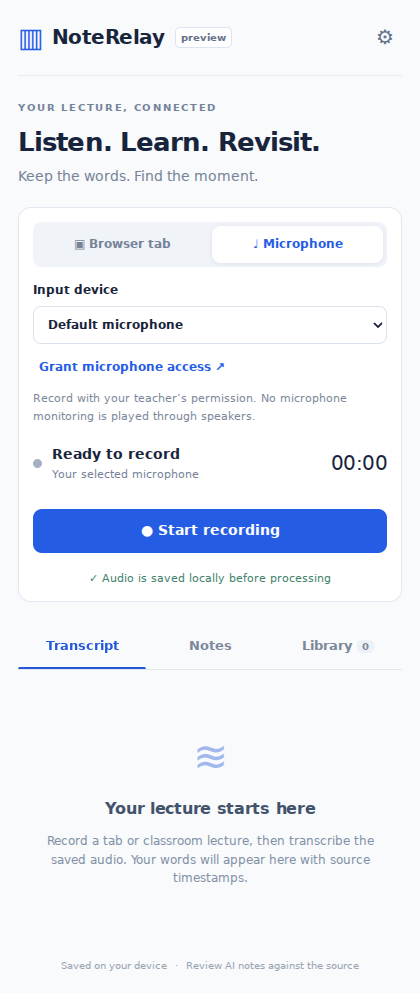

# NoteRelay

**Record. Understand. Revisit.**

A local-first Chrome extension for tab audio and classroom microphone recordings. Save the audio first, transcribe with your own Gemini key, and create study materials that link back to their transcript evidence.

> **0.2.0 preview:** desktop Chrome, one recording at a time. This is an engineering prototype, not a universal course-platform integration. Read [supported environments and limits](docs/SUPPORT.md) and [verification evidence](docs/TESTING.md).



_UI preview only; capture verification status is documented below._

## Study documents: new in 0.2.0

In **Notes**, choose **Add to study document** to create a collection or add a lecture to an existing one. Each video becomes a chapter titled from the original lecture. In **Documents**, rename/reorder/remove chapters and **Save document**. Then **Export PDF** for a selectable-text file, or export a `.noterelay.json` editable backup to reopen on another device. No copying/pasting, LaTeX installation, extra AI calls, or hosted service is needed.

[Study document guide, limits, and safe update instructions](docs/STUDY_DOCUMENTS.md). Saving locally does not update a previously downloaded PDF.

## What it does

- Choose **Browser tab** or **Microphone** before recording; select an input device.
- Start, pause, resume, and stop capture from a side panel.
- Save mono PCM audio to IndexedDB approximately every second. The offscreen engine keeps recording when the interface closes.
- Recover committed audio after a capture-engine interruption. No claim of zero data loss.
- Transcribe saved audio in bounded 30-second Gemini requests. Optionally send saved windows progressively while recording.
- Store transcripts independently; edits create new versions.
- Generate summaries, detailed notes, key concepts, takeaways, study guides, flashcards, and quizzes from text without retranscribing.
- Follow approximate source timestamps to a supported HTML5 player, or play a saved-audio excerpt.
- Keep a local lecture Library. Export TXT, Markdown, session JSON, usage measurements, and 10-minute WAV parts.
- Delete audio while keeping transcripts and notes.

## Install from source

Requirements: Node.js 22+, npm, Python 3 for ZIP packaging, and desktop Chrome 116+ (test the current stable version).

```bash
git clone https://github.com/MOULAYID/NoteRelay.git
cd NoteRelay
npm ci
npm run check
npm run package
```

1. Open `chrome://extensions`.
2. Enable **Developer mode**.
3. Choose **Load unpacked** and select the generated `dist` directory.
4. Pin NoteRelay. Open a normal video webpage, then click the NoteRelay toolbar icon.
5. Open Settings (gear), paste your Gemini key, choose models, and save.
6. For a classroom recording, open **Microphone setup**, explicitly grant microphone permission, then select Microphone in the panel.

`artifacts/NoteRelay-0.2.0.zip` contains the unpacked extension files. Extract it before loading it into Chrome. This repository is not yet a Chrome Web Store listing.

## Gemini configuration

Each user supplies their own key. Without **Remember key on this device**, it is stored in `chrome.storage.session` until the browser session ends. Remembered keys use trusted-context-only local extension storage. Neither is an encrypted credential vault. Keys are never synchronized, sent to page content scripts, exported, or bundled.

Default adapters use the Gemini **GenerateContent** REST API with audio input and validated JSON output. Default model IDs are `gemini-3.5-flash-lite` for transcription and notes; change these if your project no longer offers them. Use models supporting the required modalities and structured output. Use **Load available models** to inspect the models returned for your key, and **Test transcription audio** to send 0.25 seconds of synthetic WAV silence through the transcription path. Listing models does not prove inference/billing access; the text test does not prove audio access, and neither test proves transcription accuracy. Google restricts Gemini 2.5 access for new projects. Existing model settings are preserved; choose **Use current defaults**, test, and save to change them.

Dedicated Transcribe and Live models use different protocols and **are not adapters in 0.1.1**. Do not enter a dedicated Transcribe ID expecting it to work through GenerateContent.

Progressive uploads are **off by default**. Enable them in Settings only if you want committed audio sent to Google while recording. Otherwise, stop and click **Transcribe saved audio with Gemini**. Notes generation sends the saved transcript, not the audio.

Google API usage belongs to your project. Quotas, billing, availability, data processing, and regional distribution terms apply; a free API key is not a guarantee of free usage. See [privacy](docs/PRIVACY.md) and [official references](docs/REFERENCES.md).

## First working demonstration

1. Record 5–10 seconds of your own speech or licensed lecture audio.
2. Pause/resume, close/reopen the panel, then stop.
3. In Library, export the saved WAV part and play it independently.
4. Add your key and transcribe. Inspect the text before generating notes.
5. Generate a summary, then a quiz. These tasks reuse the transcript.
6. Click a timestamp: supported video navigation is approximate; saved audio is the fallback.
7. Edit the transcript and save a new version. Previous notes retain their original transcript version.

Do not use recordings you lack permission to make or redistribute. Ask the teacher and follow institution rules for classroom use.

## Development and checks

```bash
npm run dev          # rebuild the extension; reload it in chrome://extensions
npm run typecheck
npm run lint
npm test             # deterministic unit/storage/provider tests; no API key
npm run build
npx playwright install --with-deps chromium
npm run test:e2e      # real extension with fake microphone; no Google requests
npm run package
python3 benchmarks/evaluate.py benchmarks/fixtures/synthetic-pairs.json
```

Use `CHROMIUM_PATH=/path/to/chromium npm run test:e2e` for a compatible local browser. CI checks types, lint, deterministic tests, the bundle, browser tests, and uploads an extension artifact. Paid/live-provider tests are deliberately excluded.

## Architecture and project guide

- [Architecture, schema, and design decisions](docs/ARCHITECTURE.md)
- [Milestones and acceptance criteria](docs/ROADMAP.md)
- [Testing, benchmarks, and evidence](docs/TESTING.md)
- [Support and known limitations](docs/SUPPORT.md)
- [Privacy](docs/PRIVACY.md) · [Security](SECURITY.md) · [Contributing](CONTRIBUTING.md)

There is no hosted backend, account system, telemetry, or subscription service. The source is MIT licensed; dependency licenses remain applicable.

## Updating an installed preview without losing saved lectures

Replace the files **inside the same folder originally loaded into Chrome**, then click **Reload** on the existing NoteRelay card in `chrome://extensions`. Do not remove the extension or load a separate new folder if you need to retain its data. Stop recording and export important audio first.

For the 0.1.1 model-access fix: Settings → Use current defaults → Test transcription audio → Save settings. For an existing failed recording, return to Transcript and choose **Create new transcription version**. Failed tasks retain their original model; retrying them alone does not adopt a newly selected model. The old audio/transcripts/notes are preserved. HTTP diagnostics show a code and safe explanation without echoing provider payloads.
