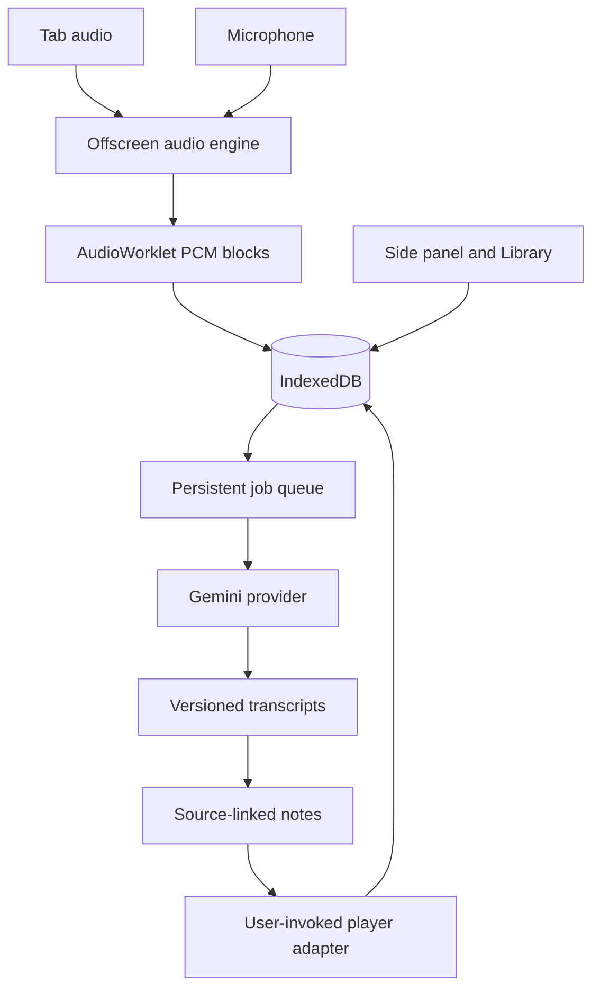

# Architecture and decisions

## Components

| Module           | Responsibility                                                                                                       |
| ---------------- | -------------------------------------------------------------------------------------------------------------------- |
| `background`     | User commands, tab-capture stream IDs, offscreen creation, trusted key access, player navigation, restart scheduling |
| `offscreen`      | Own MediaStream and AudioContext, store audio, run processing without relying on the panel                           |
| `audio/worklet`  | Downmix channels, account for actual recorded samples, flush about once per second, acknowledge pause/stop           |
| `storage`        | Atomic audio commits, bounded range reads, recovery, settings, schema                                                |
| `jobs`           | Stable transcription tasks, global processing lease, bounded retries, notes provenance                               |
| `providers`      | GenerateContent protocol and validated results; interfaces for later providers                                       |
| `content/player` | User-invoked top-frame HTML5 media observation and supported seek commands                                           |
| `ui`             | Controls, state display, editing, settings, Library, local playback and exports                                      |

Only one source and session record at a time. The service worker coordinates; it does not own the audio stream or keep the only copy of application state.

## Decision 001: native Web Audio conversion, PCM persistence

Request an AudioContext sample rate of 16 kHz; store the **actual** rate returned by Chrome. Chrome's audio graph handles conversion. The worklet downmixes input channels and outputs float blocks. Offscreen converts to signed 16-bit little-endian PCM.

The microphone is not monitored through speakers. Captured tab audio is connected to the destination so the user can still hear it. The worklet output itself is silent.

PCM costs approximately 115.2 MB/hour at 16 kHz mono. Sample-rate fallback changes that size. It avoids assuming independently emitted MediaRecorder blobs are playable files. MediaRecorder/Opus archival can be added after incomplete-container recovery is tested.

Write `{block, saved sample count, block count}` in one IndexedDB transaction. Require contiguous sequence and sample ranges. Repeated block IDs are idempotent. Reads select only the requested sample interval using a compound index. Transcription uses 30-second windows; audio exports are at most ten minutes each; local playback loads at most one minute.

Do not claim filesystem-level power-loss durability. Browser crash, OS writeback, disk failure, and the last uncommitted frames remain risks. Stop on storage failure or an excessive write queue; never label failed writes saved.

## Decision 002: lifecycles and recovery

Capture: `starting → recording ↔ paused → stopped`, with `interrupted` and `error` terminal outcomes.

On new offscreen-engine initialization, previous nonterminal sessions become `interrupted`. The engine is pinged before a new session is created, preventing recovery from misclassifying that new session. A browser restart requires a fresh user action to capture; only saved data and pending processing recover automatically.

Each job is pending, running, done, failed, or explicitly cancelled by a new transcription. A transactional global lease prevents two engine iterations claiming work at the same time. A lease expires after two minutes; requests time out at 70 seconds. Retry network/429/5xx failures with jitter, up to four attempts. Invalid credentials, invalid schema, blocked/truncated responses, and unsupported models require explicit intervention. A retry after an ambiguous request may incur another provider charge; external exactly-once billing cannot be guaranteed.

The queue is persisted. Existing transcription jobs pin the model/language for their transcript. Repeated transcription clicks reuse task IDs. Creating a new transcription version uses current model/language settings, cancels unfinished old transcription jobs, and preserves earlier transcripts and notes. Notes generation intentionally creates another output version.

## Decision 003: data model v1

| Store       | Key/indexes                                    | Main data                                                                            |
| ----------- | ---------------------------------------------- | ------------------------------------------------------------------------------------ |
| sessions    | id; createdAt; state                           | source, sanitized page URL, source tab ID, actual sample rate, saved samples, status |
| blocks      | id; sessionId; session+sequence; session+start | PCM bytes and exact sample interval                                                  |
| anchors     | auto ID; sessionId; session+audioTime          | player time, source identity, rate, event, estimated uncertainty                     |
| transcripts | id; sessionId; createdAt                       | ordered segments, source/model/language, revision, parent version                    |
| notes       | id; sessionId; transcriptId; createdAt         | format, language, model, prompt version, source segment IDs                          |
| jobs        | id; sessionId; status; nextRun                 | processing range, settings, attempts, lease, sanitized errors                        |
| usage       | id; jobId; time                                | provider-reported input/output tokens and client elapsed time                        |

Transcript edits append a complete new snapshot and preserve segment IDs inside that version. Existing notes point at their original transcript. Audio deletion keeps transcripts and notes and disables retranscription/playback. Full deletion removes linked records; running jobs must finish before deletion.

Schema changes must increment the Dexie version and add tested migrations. Do not silently reinterpret earlier stored audio formats.

## Decision 004: timestamps and source provenance

The worklet sample counter is authoritative for recording time and excludes user-paused recording. The content adapter observes media events and currentTime once per second. Anchor messages are stamped on receipt by the audio processor; `.5` seconds is an engineering uncertainty label, **not a measured error guarantee**. Capture/render/output latency needs benchmark calibration.

For short uninterrupted intervals, source time is anchor video time plus elapsed recorded time times playback rate. Reject stale (>2.5-second), paused, seeking, buffering, or missing mappings. Source changes form new intervals. Reject ambiguous multiple playing players. Treat all generative ASR times as approximate. References cite stable segment IDs, not timestamps invented by the notes model.

Top-frame HTML5 players only in 0.1.0. Cross-origin iframes, hidden players, advertisements sharing a media element, private player state, and platform redesigns can invalidate assumptions. No bypass of protected playback. Saved audio is the fallback. This is not a universal YouTube IFrame API integration.

## Decision 005: provider isolation and privacy

Use GenerateContent with inline WAV bounded to 30 seconds and schema-constrained JSON. Local Zod validation rejects malformed results, out-of-range times, invalid note source IDs, and missing lecture references. Valid JSON does not prove complete or faithful ASR. Silence may return empty segments.

No overlapping ASR windows in v0.1; a phrase crossing a window boundary may suffer deletion/repetition. This trade-off must be measured before adding overlap reconciliation or dedicated streaming ASR.

The entire text transcript is reused for notes with a conservative 800,000-character guard. Larger inputs fail explicitly. There is no silent truncation and no hierarchical summarization adapter yet.

The service worker reads credentials only for trusted extension contexts. Keys never enter player messages or exported records. No backend or external analytics. Dedicated speech-to-text and local Whisper implementations can implement the interfaces without changing storage or capture.
